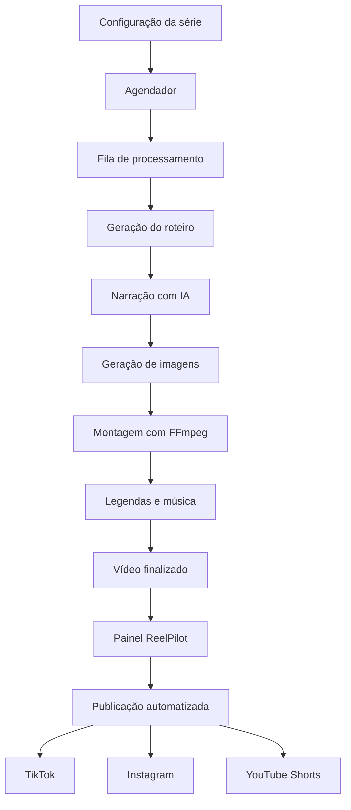

# 🎬 ReelPilot

### Plataforma SaaS de criação e publicação automatizada de vídeos com Inteligência Artificial

<p align="center">
  
  
  
  
</p>

<p align="center">
  <strong>Crie. Automatize. Publique. Escale.</strong>
</p>

<p align="center">
  Transforme ideias em vídeos curtos completos, com roteiro, narração, imagens, legendas animadas e publicação automatizada nas principais redes sociais.
</p>

<p align="center">
  
  
  
</p>

---

## 📌 Sobre o projeto

O **ReelPilot** é uma plataforma SaaS desenvolvida para automatizar a produção e distribuição de vídeos curtos sem a necessidade de aparecer diante das câmeras.

Com uma combinação de Inteligência Artificial, processamento multimídia e automações, a plataforma tem como objetivo transformar a criação de conteúdo em um processo escalável.

A proposta é permitir que criadores de conteúdo, empreendedores e gestores de redes sociais configurem séries de vídeos que serão produzidos e publicados automaticamente.

### ✨ Principais funcionalidades previstas

- 🤖 **Roteiros com IA:** geração automatizada de conteúdos utilizando Claude.
- 🎙️ **Narração inteligente:** conversão de texto em voz com Kokoro TTS.
- 🎨 **Imagens com IA:** criação de imagens personalizadas para cada cena.
- 🎞️ **Montagem automatizada:** processamento e composição de vídeos com FFmpeg.
- 💬 **Legendas dinâmicas:** legendas animadas e sincronizadas.
- 🎵 **Trilhas sonoras:** incorporação de músicas aos vídeos.
- 📅 **Agendamento:** organização da produção e das publicações.
- 📱 **Publicação multiplataforma:** integração com TikTok, Instagram e YouTube.
- 📊 **Painel centralizado:** gerenciamento de séries, vídeos e configurações.
- 🐳 **Infraestrutura Docker:** ambiente isolado, reproduzível e preparado para evolução.

> ⚠️ **Estado atual:** o projeto está em desenvolvimento. A fundação técnica (Passo 0) está concluída. Atualmente, o painel utiliza dados simulados no navegador. A geração real de vídeos, as filas de processamento e as integrações de publicação serão implementadas nas próximas etapas.

> 📝 **Observação:** ReelPilot é o nome provisório do projeto.

---

## 📑 Navegação

- [Sobre o projeto](#-sobre-o-projeto)
- [Como funciona](#-como-funciona)
- [Tecnologias](#-tecnologias)
- [Pré-requisitos](#-pré-requisitos)
- [Instalação e execução](#-instalação-e-execução)
- [Acessos locais](#-acessos-locais)
- [Comandos disponíveis](#-comandos-disponíveis)
- [Serviços Docker](#-serviços-docker)
- [Estrutura do projeto](#-estrutura-do-projeto)
- [Variáveis de ambiente](#-variáveis-de-ambiente)
- [Testes e qualidade](#-testes-e-qualidade)
- [Ambiente de produção](#-ambiente-de-produção)
- [Roadmap](#-roadmap)
- [Documentação](#-documentação)
- [Licença](#-licença)

---

## 🔄 Como funciona

O ReelPilot foi projetado para automatizar todo o ciclo de produção de vídeos, desde a configuração inicial até sua publicação.

### 01. Configuração da série

O usuário cria uma série e define:

- Nicho e temática do conteúdo.
- Idioma e formato do vídeo.
- Voz utilizada na narração.
- Estilo visual das imagens.
- Música e identidade sonora.
- Estilo das legendas.
- Redes sociais de destino.
- Frequência e horário de publicação.

### 02. Processamento automatizado

O agendador identifica os vídeos que precisam ser produzidos e encaminha as tarefas para uma fila de processamento.

O worker executa as etapas necessárias, utilizando provedores de IA e ferramentas locais.

### 03. Geração do vídeo



*Fluxo planejado para as próximas etapas do desenvolvimento.*

### 04. Publicação e gerenciamento

Após o processamento, o vídeo ficará disponível no painel para acompanhamento e gerenciamento.

A publicação será realizada automaticamente nas plataformas conectadas, conforme as configurações de cada série e as permissões disponibilizadas pelas APIs oficiais.

---

## 🛠️ Tecnologias

A arquitetura combina tecnologias web modernas, ferramentas de Inteligência Artificial e infraestrutura conteinerizada.

### Frontend e aplicação

| Tecnologia | Finalidade |
|---|---|
| **Next.js 14** | Framework principal com App Router |
| **React 18** | Construção de interfaces |
| **TypeScript** | Tipagem e segurança do código |
| **Tailwind CSS** | Estilização e design responsivo |

### Banco de dados e infraestrutura

| Tecnologia | Finalidade |
|---|---|
| **PostgreSQL 16** | Persistência de dados |
| **Redis 7** | Cache e suporte às filas |
| **BullMQ** | Gerenciamento de tarefas assíncronas (Passo 5) |
| **SeaweedFS** | Armazenamento compatível com S3 |
| **Docker Compose** | Orquestração dos serviços |
| **Caddy** | HTTPS e proxy reverso (planejado) |

### Inteligência Artificial e processamento

| Tecnologia | Finalidade | Execução |
|---|---|---|
| **Claude API** | Geração de roteiros | API externa |
| **Kokoro TTS** | Narração e síntese de voz | CPU local |
| **ComfyUI** | Orquestração de geração de imagens | GPU local |
| **FLUX.1-schnell** | Modelo generativo de imagens | GPU local |
| **FFmpeg** | Montagem e processamento audiovisual | Local |

### Testes e qualidade

| Tecnologia | Finalidade |
|---|---|
| **Vitest** | Testes unitários e de integração |
| **Playwright** | Testes end-to-end |
| **TypeScript** | Verificação estática de tipos |
| **ESLint** | Análise e padronização do código |

---

## 💻 Pré-requisitos

Para executar o ambiente atual de desenvolvimento, é necessário apenas:

- Docker Engine ou Docker Desktop.
- Docker Compose **v2.24 ou superior**.
- Git para clonar o repositório.

**Não é necessário instalar Node.js, npm, PostgreSQL, Redis ou outras dependências diretamente na máquina.**

Todos os serviços da aplicação são executados dentro de containers.

### Requisitos de GPU

As funcionalidades futuras de Inteligência Artificial local, introduzidas a partir dos Passos 7 e 8, exigirão:

- GPU NVIDIA.
- Mínimo de **12 GB de VRAM**.
- Drivers NVIDIA compatíveis.
- Suporte à utilização de GPU pelo Docker.

> 💡 A GPU não é necessária para executar a fundação atual da aplicação. Será exigida para os recursos planejados de geração local de imagens.

---

## 🚀 Instalação e execução

### 1. Obtenha o código-fonte

Clone o repositório do projeto ou baixe seu código-fonte e acesse o diretório raiz:

```bash
cd reelpilot
```

### 2. Configure as variáveis de ambiente

Crie o arquivo `.env` utilizando o modelo fornecido.

**Windows (PowerShell):**

```powershell
Copy-Item .env.example .env
```

**Linux / macOS:**

```bash
cp .env.example .env
```

Edite o `.env` e configure as credenciais e demais variáveis necessárias.

> 🔐 Nunca utilize as senhas de exemplo em ambientes públicos ou de produção.

### 3. Inicialize a aplicação

**Windows (PowerShell):**

```powershell
.\scripts\dc.ps1 up
```

**Linux / macOS:**

```bash
docker compose up -d --build --wait
```

Na primeira execução, o Docker construirá as imagens necessárias, criará os volumes e inicializará os serviços.

### 4. Acesse a plataforma

Após a inicialização, abra:

**http://localhost:3100**

O ambiente de desenvolvimento oferece recarga automática da aplicação ao modificar os arquivos.

---

## 🌐 Acessos locais

| Serviço | Endereço | Descrição |
|---|---|---|
| 🖥️ **ReelPilot** | http://localhost:3100 | Aplicação web e painel |
| 💚 **Health Check** | http://localhost:3100/api/health/ | Monitoramento de dependências |
| 📧 **Mailpit** | http://localhost:8125 | Visualização de e-mails de desenvolvimento |

As portas podem ser personalizadas no arquivo `.env`:

```env
WEB_PORT=3100
MAILPIT_PORT=8125
```

O endpoint de saúde verifica os serviços essenciais, incluindo banco de dados, Redis e armazenamento.

---

## ⌨️ Comandos disponíveis

O projeto conta com um script PowerShell que centraliza as operações do Docker.

### Desenvolvimento

| Comando | Descrição |
|---|---|
| `.\scripts\dc.ps1 up` | Inicializa o ambiente |
| `.\scripts\dc.ps1 down` | Interrompe os containers |
| `.\scripts\dc.ps1 ps` | Lista serviços e estados |
| `.\scripts\dc.ps1 logs` | Exibe os logs |
| `.\scripts\dc.ps1 logs web` | Exibe os logs da aplicação |
| `.\scripts\dc.ps1 shell` | Abre um terminal no container web |

### Dependências

Instale pacotes diretamente no container:

```powershell
.\scripts\dc.ps1 npm install <pacote>
```

> ⚠️ **Importante:** não execute instalações de dependências com o npm da máquina host. O `package-lock.json` deve ser gerado dentro do ambiente Linux do container, garantindo consistência entre os ambientes.

### Banco de dados

| Comando | Descrição |
|---|---|
| `.\scripts\dc.ps1 migrate` | Aplica as migrações pendentes (o `up` também aplica, pelo serviço `migrate`) |
| `.\scripts\dc.ps1 db-generate <nome>` | Gera uma migração nova a partir de `src/server/db/schema.ts` |
| `.\scripts\dc.ps1 seed` | Recria a conta de demonstração `creator@example.com` com séries, vídeos e créditos |
| `.\scripts\dc.ps1 psql` | Abre o terminal SQL do banco de desenvolvimento |

> Toda mudança no schema vira um arquivo SQL versionado em `drizzle/`. Nunca altere o banco à mão nem edite uma migração já aplicada: gere uma nova.

### Testes e validação

| Comando | Descrição |
|---|---|
| `.\scripts\dc.ps1 test` | Executa os testes com Vitest (os testes de banco usam um banco `_test` recriado do zero a cada execução) |
| `.\scripts\dc.ps1 e2e` | Executa os testes Playwright (zera antes os contadores de tentativas do Redis de desenvolvimento, porque cada rodada cria várias contas) |
| `.\scripts\dc.ps1 check` | Executa lint, verificação de tipos e testes |

### Produção

| Comando | Descrição |
|---|---|
| `.\scripts\dc.ps1 prod-build` | Constrói a imagem de produção |
| `.\scripts\dc.ps1 prod-up` | Inicializa o ambiente de produção |

### Reinicialização completa

```powershell
.\scripts\dc.ps1 reset
```

**⚠️ ATENÇÃO: operação destrutiva.**

Esse comando remove os volumes persistentes utilizados pelo projeto, incluindo:

- Dados do PostgreSQL.
- Dados persistidos do Redis.
- Arquivos do armazenamento SeaweedFS.

Após a remoção, o ambiente é inicializado novamente.

Utilize somente quando precisar recriar completamente o ambiente local.

---

## 🐳 Serviços Docker

Todos os componentes atuais são orquestrados pelo Docker Compose.

| Serviço | Imagem | Responsabilidade |
|---|---|---|
| `web` | Dockerfile (`dev`) | Aplicação Next.js |
| `migrate` | Dockerfile (`dev`; `runner-migrate` em produção) | Aplica as migrações e encerra; o `web` só sobe depois dele |
| `postgres` | `postgres:16.6-alpine` | Banco de dados relacional |
| `redis` | `redis:7.4.1-alpine` | Cache e infraestrutura de filas |
| `s3` | `chrislusf/seaweedfs:4.51` | Armazenamento de arquivos |
| `s3-init` | `amazon/aws-cli:2.39.7` | Inicialização do bucket |
| `mailpit` | `axllent/mailpit:v1.21.8` | Captura de e-mails |
| `e2e` | `mcr.microsoft.com/playwright:v1.64.1-noble` | Testes automatizados E2E |

O serviço `e2e` é executado sob demanda com o perfil de testes.

### Serviços planejados

| Serviço | Responsabilidade |
|---|---|
| `worker` | Processamento de tarefas |
| `scheduler` | Agendamento de geração e publicação |
| `kokoro` | Síntese de voz local |
| `comfyui` | Geração de imagens com IA |
| `caddy` | Proxy reverso e HTTPS |

---

## 📁 Estrutura do projeto

```text
reelpilot/
│
├── src/
│   ├── app/
│   │   └── api/
│   │       └── health/
│   │
│   ├── components/
│   ├── lib/
│   ├── server/
│   │   ├── db/
│   │   │   ├── schema.ts
│   │   │   ├── credits.ts
│   │   │   └── index.ts
│   │   ├── accounts.ts
│   │   ├── crypto.ts
│   │   ├── health.ts
│   │   ├── password.ts
│   │   └── rate-limit.ts
│   ├── test/
│   ├── auth.ts
│   ├── auth.config.ts
│   ├── middleware.ts
│   └── instrumentation.ts
│
├── drizzle/
│
├── e2e/
│
├── docker/
│
├── scripts/
│   ├── dc.ps1
│   ├── migrate.mjs
│   └── seed.ts
│
├── drizzle.config.ts
├── .env.example
├── Dockerfile
├── CONTEXTO.md
└── README.md
```

### Organização das responsabilidades

| Diretório / Arquivo | Responsabilidade |
|---|---|
| `src/app` | Páginas, layouts e rotas da API |
| `src/components` | Componentes visuais reutilizáveis |
| `src/lib` | Utilitários compartilhados: opções do assistente, planos, tipos da API e cliente da API (SWR) |
| `src/server` | Lógica exclusiva do servidor |
| `src/server/db/schema.ts` | Schema do banco (Drizzle): usuários, séries, vídeos, etapas, créditos, assinaturas e redes sociais |
| `src/server/db/credits.ts` | Saldo de créditos, calculado pela soma do extrato |
| `src/server/crypto.ts` | Criptografia AES-256-GCM dos tokens das redes sociais |
| `src/server/accounts.ts` | Cadastro, verificação de senha, limites de tentativas e versão de sessão |
| `src/server/password.ts` | Hash de senha com argon2id |
| `src/server/rate-limit.ts` | Contadores de tentativas no Redis |
| `src/server/series.ts` | Séries: validação contra as opções do assistente e acesso só do dono |
| `src/components/dashboard/series-fields.tsx` | Campos da série, compartilhados pelo assistente de criação e pela tela de edição |
| `src/components/dashboard/music-picker.tsx` | Escolha da música: upload, importação por link e biblioteca |
| `src/server/videos.ts` | Vídeos e créditos: débito com trava por usuário, estornos |
| `src/server/me.ts` | Conta: plano, saldo, preferências e contas sociais |
| `src/server/storage.ts` | Armazenamento S3: gravar, ler, listar e apagar arquivos e pastas |
| `src/server/music.ts` | Biblioteca de música: upload, importação por link, exclusão |
| `src/server/audio-file.ts` | Reconhece MP3 e WAV pelos bytes do arquivo |
| `src/server/safe-fetch.ts` | Download de links digitados pelo usuário com proteção contra SSRF |
| `src/server/media-url.ts` | Links assinados e de validade curta para os arquivos |
| `src/auth.ts` | Configuração completa do Auth.js (provedores, sessão JWT, conferência no banco) |
| `src/auth.config.ts` | Parte da configuração que roda no Edge (usada pelo middleware) |
| `src/middleware.ts` | Protege `/dashboard` e a API privada; adiciona a barra final às URLs de páginas |
| `src/test` | Preparação dos testes (banco `_test` recriado a cada execução) |
| `src/instrumentation.ts` | Validação inicial das variáveis de ambiente |
| `drizzle` | Migrações SQL versionadas |
| `e2e` | Cenários de testes Playwright |
| `docker` | Configurações e entrypoints |
| `scripts/dc.ps1` | Automação de comandos Docker |
| `scripts/migrate.mjs` | Aplica as migrações (usado pelo serviço `migrate`) |
| `scripts/seed.ts` | Dados de demonstração para desenvolvimento |

A estrutura será ampliada conforme os módulos de geração, processamento e publicação forem implementados.

---

## 🔐 Variáveis de ambiente

Todas as configurações necessárias estão documentadas no arquivo:

**[`.env.example`](.env.example)**

A aplicação realiza a validação das variáveis durante a inicialização por meio de:

```text
src/lib/env.ts
```

Caso alguma configuração obrigatória esteja ausente ou inválida, o servidor interromperá a inicialização e apresentará os erros encontrados.

### Boas práticas

- Nunca versionar o arquivo `.env`.
- Não compartilhar tokens ou chaves de API.
- Utilizar credenciais diferentes para desenvolvimento e produção.
- Substituir todas as senhas padrão.
- Manter o `.env.example` atualizado.
- Gerar a `ENCRYPTION_KEY` com `openssl rand -base64 32` e guardá-la com cuidado: sem ela, os tokens das redes sociais salvos no banco ficam ilegíveis.
- Gerar o `AUTH_SECRET` da mesma forma. Trocá-lo desconecta todos os usuários.
- Usar `AUTH_RATE_LIMIT_SCALE=1` em produção. O valor maior (50) serve só para o desenvolvimento, onde os testes de ponta a ponta fazem muitos logins seguidos.

---

## 🔌 API do painel

Todas as rotas exigem login (sem sessão: `401`). Registro de outro usuário ou id inválido respondem `404`, para não revelar que existe.

| Método e rota | O que faz |
|---|---|
| `GET /api/me` | Perfil, preferências, plano, saldo de créditos e contas sociais conectadas |
| `PATCH /api/account` | Atualiza nome, fuso, notificações por e-mail e publicação automática |
| `GET /api/series` | Séries do usuário, com total de vídeos e de publicados |
| `POST /api/series` | Cria uma série com os campos do assistente |
| `GET` / `PATCH` / `DELETE /api/series/:id` | Detalhe, edição (inclusive pausar e retomar) e exclusão |
| `POST /api/series/:id/videos` | Coloca um vídeo novo na fila e cobra 1 crédito (`402` sem crédito) |
| `GET /api/videos?seriesId=` | Vídeos do usuário (os 100 mais recentes), opcionalmente de uma série |
| `GET` / `DELETE /api/videos/:id` | Detalhe e exclusão |
| `DELETE /api/social-connections/:id` | Desconecta uma rede social |
| `GET /api/music` | Biblioteca de música do usuário, com links de reprodução assinados |
| `POST /api/music` | Envia um MP3 ou WAV (até 10 MB) como corpo da requisição; nome original no cabeçalho `X-File-Name` |
| `POST /api/music/import` | Importa `{ url }` de um MP3/WAV (só `https`, até 10 MB) |
| `DELETE /api/music/:id` | Remove a faixa da biblioteca, das séries e do armazenamento |
| `GET /api/media/<arquivo>?exp=&sig=` | Entrega um arquivo por link assinado (sem login; o link é a permissão), com suporte a `Range` |

Os campos das séries incluem `musicTrackIds` (até 10 faixas da própria biblioteca).

### Arquivos

- **Bucket privado:** fica dentro da rede do Docker e nunca é exposto. O navegador envia e recebe arquivos pelo app.
- **Upload:** o servidor confere o conteúdo real (bytes de MP3 ou WAV, não a extensão) e o tamanho antes de gravar. Respostas: `413` acima de 10 MB e `429` acima de 30 envios por hora.
- **Importação por link:** só `https`. O endereço é resolvido na hora da conexão e recusado se apontar para a rede interna (127.x, 10.x, 192.168.x, 169.254.169.254, serviços do Docker...). Redirecionamentos são conferidos e o download para em 10 MB.
- **Links de reprodução:** valem 30 minutos e só para o arquivo para o qual foram gerados.
- **Pastas:** `users/<usuário>/music/...` e `users/<usuário>/videos/<vídeo>/...`. Excluir um vídeo, uma série ou a conta apaga os arquivos correspondentes.

### Regras de créditos

- O saldo é sempre a soma do extrato (`credit_ledger`).
- Gerar um vídeo cobra 1 crédito na mesma transação, com uma trava por usuário no Postgres: cliques simultâneos nunca deixam o saldo negativo.
- Um vídeo que falha devolve o crédito uma única vez.
- Excluir um vídeo que ainda está na fila devolve o crédito; excluir uma série devolve os créditos dos vídeos dela que estavam na fila.

---

## 🔑 Login e contas

- **Cadastro e login com e-mail e senha:** senhas guardadas com argon2id. O e-mail não diferencia maiúsculas de minúsculas.
- **Login com Google:** fica ativo quando `AUTH_GOOGLE_ID` e `AUTH_GOOGLE_SECRET` estão preenchidos. No Google Cloud Console, crie um "ID do cliente OAuth" do tipo aplicativo da Web, com o redirecionamento autorizado `<APP_URL>/api/auth/callback/google` (no desenvolvimento, `http://localhost:3100/api/auth/callback/google`). Sem essas variáveis, o botão avisa que o Google ainda não está disponível.
- **Sessão:** JWT válido por 2 horas sem atividade, renovado automaticamente enquanto o painel está aberto. A cada minuto o servidor confere a sessão no banco, então uma conta excluída ou o "Sign out of all devices" (em Settings) derruba as sessões abertas em até 1 minuto.
- **Proteção contra tentativas repetidas** (contadores no Redis):

  | Limite | Valor |
  |---|---|
  | Senhas erradas por e-mail | 5 a cada 15 minutos |
  | Tentativas de login por IP | 30 a cada 15 minutos |
  | Cadastros por IP | 5 por hora |

- **Rotas protegidas:** `/dashboard/**` e toda a API, menos `/api/auth`, `/api/health` e `/api/register`. Quem não está logado vai para o login e volta à página pedida depois de entrar.

> ⚠️ Em produção, o limite por IP depende do proxy reverso (Caddy) sobrescrever o `X-Forwarded-For` com o IP real e de o container `web` não ter porta publicada. Sem isso, o cabeçalho pode ser falsificado pelo cliente.

---

## 🧪 Testes e qualidade

O ReelPilot utiliza ferramentas de testes automatizados e validação estática para melhorar a confiabilidade do código.

### Testes unitários e de integração

```powershell
.\scripts\dc.ps1 test
```

Executados com **Vitest**.

### Testes end-to-end

```powershell
.\scripts\dc.ps1 e2e
```

Executados com **Playwright** em um container dedicado, contra o servidor de desenvolvimento. Antes da bateria, o `e2e/warmup.ts` visita todas as páginas do painel para elas já estarem compiladas.

### Dados de pior caso (só no desenvolvimento)

Para testar telas com dados difíceis (nomes muito longos, listas cheias, campos vazios), o painel aceita `?data=worst`, `?data=empty` (sem contas conectadas e com saldo zero), `?data=one` ou `?data=huge` na URL, e mostra um seletor recolhido ("Data: …") no rodapé para trocar entre eles. Os dados ficam em `src/lib/dev-data.ts` e substituem as respostas da API só no navegador; salvar nesse modo vai para a API real.

Essa ferramenta **não existe na build de produção**: o seletor e os dados são carregados com uma condição que o bundler descarta. Os testes `e2e/break-ui.spec.ts` usam esses dados para garantir que as telas continuam resistindo a eles.

### Validação completa

```powershell
.\scripts\dc.ps1 check
```

Executa as verificações configuradas de:

- Tipagem TypeScript.
- Lint e padrões de código.
- Testes unitários e de integração.
- Testes end-to-end.

---

## 🌍 Ambiente de produção

O projeto utiliza o modo `standalone` do Next.js para construir uma imagem otimizada de produção.

### Construir a imagem

```powershell
.\scripts\dc.ps1 prod-build
```

Imagem resultante:

```text
reelpilot-web:local
```

A imagem utiliza uma configuração de execução sem privilégios de root.

### Inicializar a produção

```powershell
.\scripts\dc.ps1 prod-up
```

### Recursos planejados para deploy

A preparação completa para hospedagem em VPS está prevista para o **Passo 19**, incluindo:

- Configuração de domínio.
- HTTPS com Caddy.
- Worker de processamento.
- Agendador de tarefas.
- Rotinas de backup.
- Implantação e operação em VPS.

> ⚠️ O ambiente de produção ainda está em evolução. A existência de uma imagem `standalone` não significa que a plataforma esteja pronta para operação pública.

---

## 🗺️ Roadmap

O desenvolvimento é feito de forma incremental, em etapas numeradas (Passo 0 a Passo 19) de um plano de trabalho mantido localmente, fora do repositório.

### Fundação e infraestrutura

- [x] Fundação inicial do projeto — Passo 0
- [x] Ambiente Docker de desenvolvimento
- [x] Aplicação Next.js 14
- [x] Serviços PostgreSQL, Redis e SeaweedFS
- [x] Monitoramento básico de saúde
- [x] Configuração do ambiente de testes
- [x] Banco de dados com Drizzle, migrações versionadas e seed — Passo 1
- [x] Autenticação real: e-mail/senha, Google, sessão JWT e limites de tentativas — Passo 2
- [x] API de séries, vídeos e créditos; painel sem dados no navegador — Passo 3

### Aplicação e processamento

- [x] Persistência real dos dados do painel
- [x] Gerenciamento das séries (criar, editar todos os campos e a música, pausar, retomar, excluir)
- [x] Música de fundo (upload e importação) e armazenamento privado — Passo 4
- [ ] Filas e processamento assíncrono — Passo 5
- [ ] Integração com provedores de roteiro
- [ ] Geração local de narração
- [ ] Geração local de imagens
- [ ] Montagem automatizada dos vídeos
- [ ] Sincronização de legendas e áudio

### Automação e publicação

- [ ] Agendamento automatizado de vídeos
- [ ] Integração com TikTok
- [ ] Integração com Instagram
- [ ] Integração com YouTube
- [ ] Monitoramento de tarefas e publicações

### Produção e escalabilidade

- [ ] Ambiente completo de produção — Passo 19
- [ ] HTTPS e proxy reverso
- [ ] Backups e recuperação
- [ ] Deploy na VPS

> O roadmap acima é uma visão resumida. O que já foi implementado e as decisões técnicas de cada etapa ficam registrados no [CONTEXTO.md](CONTEXTO.md).

---

## 📚 Documentação

A documentação do projeto está organizada em arquivos específicos para facilitar a continuidade do desenvolvimento.

| Documento | Descrição |
|---|---|
| 📖 **[README.md](README.md)** | Apresentação e instruções gerais |
| 🧠 **[CONTEXTO.md](CONTEXTO.md)** | Histórico, contexto e decisões técnicas |
| ⚙️ **[.env.example](.env.example)** | Modelo de configuração do ambiente |

**Recomendação:** antes de implementar uma nova funcionalidade, consulte o `CONTEXTO.md` para preservar a arquitetura e as decisões já tomadas.

---

## 🔒 Licença

**Projeto privado e proprietário.**

Todos os direitos reservados.

O código-fonte, a documentação e os demais componentes não podem ser copiados, modificados, redistribuídos ou utilizados comercialmente sem autorização expressa do proprietário.

---

<p align="center">
  <strong>🎬 ReelPilot</strong>
</p>

<p align="center">
  <em>Do roteiro à publicação. Conteúdo automatizado com Inteligência Artificial.</em>
</p>

<p align="center">
  <sub>Desenvolvido com Next.js, TypeScript, Docker e Inteligência Artificial.</sub>
</p>

<p align="center">
  <sub>© 2026 ReelPilot. Todos os direitos reservados.</sub>
</p>
